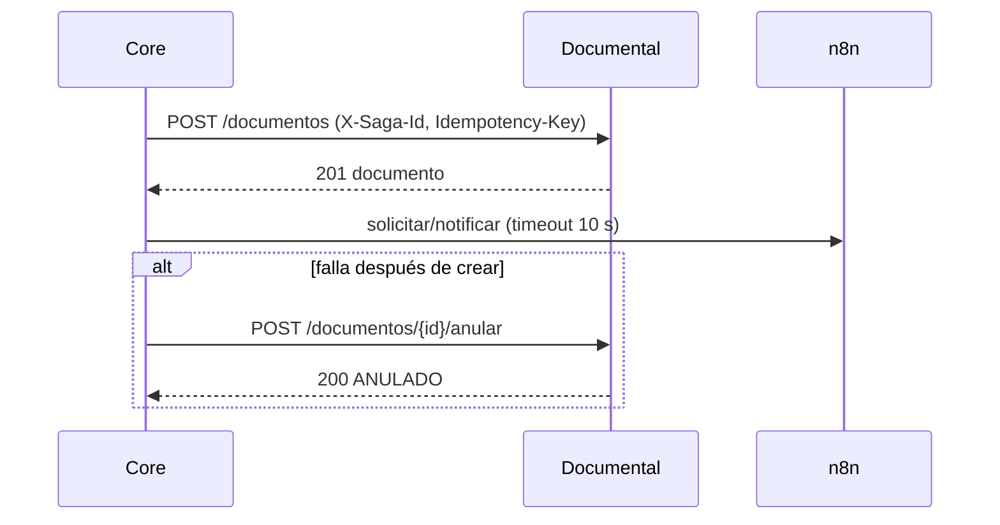

# Sagas del servicio documental

Este servicio no usa broker ni `outbox`. El core coordina las llamadas HTTP y,
cuando corresponde, invoca el webhook de n8n. Cada llamada puede llevar
`X-Saga-Id`, que se persiste en el documento y en la auditoría.

## Sagas de T00

- **Dieta:** core crea la dieta, solicita el PDF y notifica. Si la generación
  o notificación falla, compensa anulando el documento.
- **Reporte generativo:** core solicita el reporte, espera el documento y
  compensa con `anular` si n8n no confirma.
- **Factura:** core registra la factura, solicita el PDF y notifica al
  paciente; una falla posterior compensa anulando el documento.

Las llamadas usan timeout de 10 segundos y hasta 3 reintentos con la misma
`Idempotency-Key`. Después se ejecuta la compensación. `anular` es idempotente:
anular un documento `PENDIENTE` o `GENERADO` funciona; repetir la operación
sobre `ANULADO` devuelve el mismo estado. Un documento `FALLIDO` conserva el
conflicto 409 porque no contiene un artefacto válido que compensar.
